<h1 align="center">Jagannath Patro
  
</h1>

 

<i>Software Developer building backend services, REST APIs & LLM-powered systems in Python</i>

 

<i>Like what you see? Let's connect on [LinkedIn](https://www.linkedin.com/in/jagannath-patro-37a192250/) or drop me an [email](mailto:jagannathpatro234@gmail.com) 🙂</i>

## Contents

- [About Me](#-about-me)
- [Impact in Numbers](#-impact-in-numbers)
- [Work Experience](#-work-experience)
- [Projects](#-projects)
  - [At Bilvantis 🏢](#at-bilvantis-)
  - [Open Source 🧪](#open-source-)
- [Skills](#-skills)
  - [Languages 💻](#languages-)
  - [Backend & APIs 🔧](#backend--apis-)
  - [AI & LLM 🤖](#ai--llm-)
  - [Databases & Cache 💾](#databases--cache-)
  - [Cloud & DevOps 🚢](#cloud--devops-)
  - [Frontend 🎨](#frontend-)
  - [Testing & QA 🧪](#testing--qa-)
  - [AI Coding Tools 🪄](#ai-coding-tools-)
- [Education](#-education)
- [Certifications](#-certifications)
- [Achievements](#-achievements)
- [Metrics & Graphs](#-metrics--graphs)
- [Contact](#-contact)

## 👋 About Me

- 🔭 I'm a **Programmer Analyst at Bilvantis Technologies**, working on Python, AI and full-stack systems.
- ⚡ I build **production services and data pipelines**, including FastAPI REST APIs, document ingestion and LLM-powered automation.
- 🤖 I work with **Anthropic, Gemini, OpenAI and Databricks** models every day.
- 🌱 I'm currently going deeper into **AI agents, multi-agent systems and LLM evaluation**.
- 💬 Ask me about **FastAPI, RAG, Redis caching, rate limiting and LLM cost optimization**.
- 🎯 I'd like to join a growth-focused engineering team building scalable, reliable products.

## 📈 Impact in Numbers

  

## 💼 Work Experience

#### Bilvantis Technologies 🏢

- **Programmer Analyst (Python, AI & Full Stack)** — Oct 2025 – Present · Hyderabad
- I build AI developer tools, internal LLM platforms and automated QA systems for enterprise clients.

## 🚀 Projects

#### At Bilvantis 🏢

- **AI-Guard: LLM API Gateway & Usage Monitor** — a production proxy that unifies access, token tracking and cost governance across **4 LLM providers**. Redis caching and rate limiting cut token use by **60%**, and automated quota monitoring cut manual tracking by **90%**. *Node.js · Koa · Redis · MongoDB · AWS EC2 · Brevo*
- **Genie: AI-Powered VS Code Extension** — **7 command-palette features** (code generation, code reviews, unit tests, repo docs, codebase analysis) for an enterprise banking client. A LangChain agentic pipeline and optimized context management cut AI token costs by **80%**. *Python · FastAPI · TypeScript · LangChain · GitHub Copilot API*
- **Code Converter: AI Repository Migration Platform** — migrates whole codebases between languages and frameworks by mapping their architecture and dependency graphs first. It ships **5 migration capabilities**: state, React Context, props, routing and API layers. *Python · FastAPI · PostgreSQL · LangChain · Gemini · React · shadcn/ui*
- **MagickVoice: AI Voice-Agent QA System** — automated testing for an AI voice-calling platform, using an LLM-as-judge stack of **3 tools** (SkyTest Agent, simulate-sdk, DeepEval) orchestrated in CircleCI, plus SIP telephony via VoBiz. *Python · CircleCI · SIP · DeepEval*
- **RAG File Query Chatbot (internal tool)** — upload documents and query them in natural language. It runs a LangChain ingestion pipeline on PostgreSQL vector search and can switch between **3 LLM providers** at runtime. *Python · FastAPI · PostgreSQL · LangChain*

#### Open Source 🧪

- [booking_microservice](https://github.com/jagan786786/booking_microservice) — a booking service built as an independently deployable microservice.
- [TaskBoard](https://github.com/jagan786786/TaskBoard) — a task-management board, with a Jenkins CI pipeline in [taskboard-ci](https://github.com/jagan786786/taskboard-ci).
- [Cricket-Association](https://github.com/jagan786786/Cricket-Association) — a full-stack association platform, with a separate [Express backend](https://github.com/jagan786786/Cricket-Association-Backend).
- [chat_application](https://github.com/jagan786786/chat_application) — a real-time chat application.
- [unidashboard](https://github.com/jagan786786/unidashboard) — a university dashboard built in TypeScript.
- [Jagannath_portfolio](https://github.com/jagan786786/Jagannath_portfolio) — my personal portfolio ([live](https://jagannath-portfolio.vercel.app)).

## 🛠 Skills

  

#### Languages 💻

- Python, SQL, Java, JavaScript (ES6+), TypeScript

#### Backend & APIs 🔧

- FastAPI, Node.js, Express.js, NestJS, Koa.js, REST APIs, WebSockets, JWT Authentication

#### AI & LLM 🤖

- Generative AI, LLMs, NLP, RAG, AI Agents, Multi-Agent Systems, LangChain, Prompt Engineering
- LLM Evaluation (LLM-as-judge, DeepEval), Voice AI, OpenAI, Anthropic, Gemini, Databricks

#### Databases & Cache 💾

- PostgreSQL, MySQL, MongoDB, Redis, Vector Databases

#### Cloud & DevOps 🚢

- AWS (EC2, S3, RDS), Docker, CircleCI (CI/CD), GitHub-based development, Netlify

#### Frontend 🎨

- HTML, CSS, React (Material UI, shadcn/ui), Next.js, Bootstrap

#### Testing & QA 🧪

- Unit testing, integration testing, API testing, automated QA, code reviews, voice-call evaluation

#### AI Coding Tools 🪄

- Claude Code, Cursor, GitHub Copilot, Antigravity

## 🎓 Education

- **GIET University, Gunupur** — B.E. in Computer Science and Engineering · Jul 2021 – May 2025 · CGPA **8.4/10**
- Coursework — Software Engineering, Operating Systems, Data Structures & Algorithms, DBMS, Artificial Intelligence

## 📜 Certifications

- [Anthropic](https://www.anthropic.com) — Claude MCP Integration · Claude Code in Action
- HackerRank — Java Basics (4★) · SQL (3★)
- NPTEL — Joy of Computing Using Python
- Cambridge — English Language Certificate (Capable Program)
- Object-Oriented PHP & MVC — Certificate of Completion

## 🏆 Achievements

- 🥇 1st prize, block-level general knowledge competition
- 🥇 1st prize, district-level debate competition
- 🥉 3rd prize, state-level debate competition
- 🏏 Champion, district-level cricket tournament

## 📊 Metrics & Graphs

#### 🏆 Trophies

#### 📌 At a glance

#### 🧮 Languages & productivity

#### 🔥 Streak

#### 📉 Contribution activity

#### 🐍 Contribution snake

<picture>
  <source media="(prefers-color-scheme: dark)" srcset="https://raw.githubusercontent.com/jagan786786/jagan786786/output/snake-dark.svg" />
  
</picture>

## 📫 Contact

- 💼 LinkedIn — [in/jagannath-patro-37a192250](https://www.linkedin.com/in/jagannath-patro-37a192250/)
- 📧 Email — [jagannathpatro234@gmail.com](mailto:jagannathpatro234@gmail.com)
- 🌐 Portfolio — [jagannath-portfolio.vercel.app](https://jagannath-portfolio.vercel.app)

