<h1 align="center">Jagannath Patro
  
</h1>

 

<i>Software Developer building backend services, REST APIs & LLM-powered systems in Python</i>

 

<i>Like what you see? Let's connect on [LinkedIn](https://www.linkedin.com/in/jagannath-patro-37a192250/) or drop me an [email](mailto:jagannathpatro234@gmail.com) 🙂</i>

  
  
  
  
  
  
  

## 👋 About

## 📈 Impact

## 🧭 Journey

## 🚀 Projects

<table>
  <tr>
    <td width="50%"></td>
    <td width="50%"></td>
  </tr>
  <tr>
    <td width="50%"></td>
    <td width="50%"></td>
  </tr>
  <tr>
    <td width="50%"></td>
    <td width="50%"></td>
  </tr>
</table>

Work projects at Bilvantis Technologies are private; the cards above summarise them.

### 🧪 Open Source

  
  
  
  
  
  

## 🛠 Skills

  

## 🎓 Credentials

## 📊 Metrics & Graphs

#### 📌 At a glance

#### 🧮 Languages & productivity

#### 🔥 Streak

#### 🟦 Contribution heatmap

#### 🐍 Contribution snake

<picture>
  <source media="(prefers-color-scheme: dark)" srcset="https://raw.githubusercontent.com/jagan786786/jagan786786/output/snake-dark.svg" />
  
</picture>

## 📫 Contact

  
  
  

